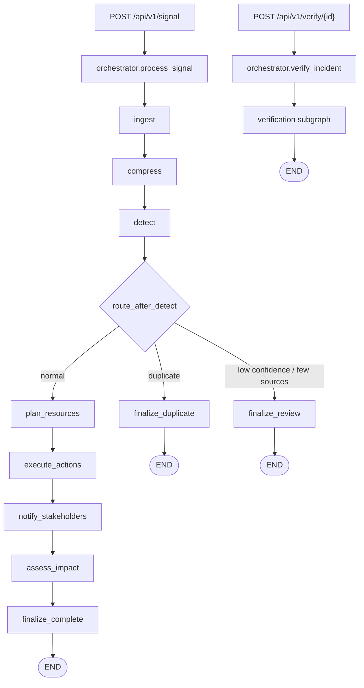
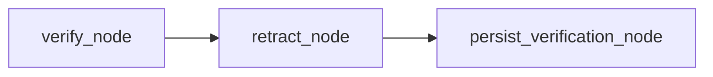

# NigehbaanAI — `agents/` package

This folder is the **LangGraph runtime** for crisis intelligence. It is separate from [`.agents/skills/`](../.agents/skills/) (Cursor agent skills / documentation for humans and the IDE).

**Project docs:** [Documentation index](../docs/README.md) · [Architecture](../docs/architecture.md) · [API reference](../docs/api-reference.md)

**Production entry:** [`orchestrator.py`](orchestrator.py) — called by FastAPI when a signal is submitted or verified.

---

## Concept in one paragraph

A **signal** (location, description, optional source flags) enters the pipeline. The system **ingests** mock or real-ish data from weather, traffic, social, and emergency-call tools, **compresses** that into a small digest for the LLM, then runs **one merged detection** call (fusion + crisis type + severity). Depending on confidence, duplicates, and source count, it either **plans resources**, **executes** simulated actions, **notifies** stakeholders, and **assesses impact**, or it exits early as duplicate / human review. A separate **verification** graph handles field reports that confirm, correct, or retract a false alarm.

---

## Main pipeline flow

**State** travels through every node as a shared [`CrisisState`](graph/state.py) dict (signals, detection, plan, execution, warnings, status, etc.).

---

## Verification flow (separate graph)

Used when an operator submits a **field report** after an incident was processed.

---

## Top-level files

| File | Purpose |
|------|---------|
| [`path_setup.py`](path_setup.py) | Adds repo root and `backend/` to `sys.path` so imports like `app.database.mock_store` work when running agents outside Docker. Imported early by orchestrator and several nodes. |
| [`config.py`](config.py) | Shared settings: `GOOGLE_API_KEY`, `MODEL_ID`, default resource caps, **JSONL trace logging** (`agents/traces/trace_log.jsonl`), pipeline stats (`llm_calls`, `tool_calls`). |
| [`orchestrator.py`](orchestrator.py) | **Main entry point.** Builds initial state, runs `compile_main_graph().invoke()`, handles errors and quota messages; exposes `verify_incident()` for the verification graph. |
| [`llm.py`](llm.py) | Gemini via `langchain-google-genai`: structured output (`invoke_structured`) and small text calls (`invoke_text`). Honors `LLM_MODE` (`mock` / `auto` / `real`) and mock fallbacks on quota errors. |
| [`mock_llm_payloads.py`](mock_llm_payloads.py) | Deterministic JSON used when `LLM_MODE=mock` or when auto-mode falls back — keeps tests and demos working without API keys. |

---

## `graph/` — LangGraph wiring

| File | Purpose |
|------|---------|
| [`graph/__init__.py`](graph/__init__.py) | Exports `compile_main_graph`, `compile_verification_graph`. |
| [`graph/build.py`](graph/build.py) | Defines the **main graph**: nodes, edges, conditional branch after `detect`, and cached `compile_*` functions. |
| [`graph/state.py`](graph/state.py) | **`CrisisState`** TypedDict — the single shared state object for all nodes. |
| [`graph/edges.py`](graph/edges.py) | **`route_after_detect`**: duplicate → `finalize_duplicate`; skip response → `finalize_review`; else → planning. |
| [`graph/schemas.py`](graph/schemas.py) | Pydantic models for LLM outputs (`DetectionResult`, `ResponsePlan`, `VerificationOutput`, etc.). |
| [`graph/verification.py`](graph/verification.py) | Builds and runs the **verification** `StateGraph` (verify → retract → persist). |

### `graph/nodes/` — one function per pipeline step

| Node file | Graph node name | What it does |
|-----------|-----------------|--------------|
| [`ingest.py`](graph/nodes/ingest.py) | `ingest` | Parallel fetch from weather, traffic, social, emergency tools; degraded-mode warnings and fallbacks. |
| [`compress.py`](graph/nodes/compress.py) | `compress` | Rule-based **signal digest** (no LLM) to cut tokens for later prompts. |
| [`detect.py`](graph/nodes/detect.py) | `detect` | **One LLM call** for fusion + classification + severity; duplicate check; may set `skip_response`. |
| [`plan.py`](graph/nodes/plan.py) | `plan_resources` | LLM resource plan; applies caps via `enforce_resource_caps`. |
| [`execute.py`](graph/nodes/execute.py) | `execute_actions` | Runs each plan step through [`graph/services/actions.py`](graph/services/actions.py) (maps, alerts). |
| [`notify.py`](graph/nodes/notify.py) | `notify_stakeholders` | Templates + optional small LLM polish for public/emergency messaging. |
| [`impact.py`](graph/nodes/impact.py) | `assess_impact` | Deterministic before/after impact metrics by crisis type. |
| [`finalize.py`](graph/nodes/finalize.py) | `finalize_*` | Writes incident to mock store, sets status (`completed`, `duplicate_detected`, `human_review_required`), logs final outcome. |

### `graph/services/` — shared logic (not LangGraph nodes)

| File | Purpose |
|------|---------|
| [`services/actions.py`](graph/services/actions.py) | Dispatches plan actions to tools (reroute, ambulance, alerts, dispatch, etc.). |
| [`services/resources.py`](graph/services/resources.py) | Enforces ambulance/police/rescue caps against `DEFAULT_RESOURCES` in config. |
| [`services/__init__.py`](graph/services/__init__.py) | Re-exports `run_action_executor`, `enforce_resource_caps`. |

---

## `tools/` — simulated external APIs

Each tool returns structured mock data tagged `[SIMULATED]`. They are **not** LangGraph nodes; nodes call them directly.

| File | Simulates |
|------|-----------|
| [`weather_tool.py`](tools/weather_tool.py) | Weather / rainfall for a location. |
| [`traffic_tool.py`](tools/traffic_tool.py) | Congestion, blocked roads. |
| [`social_tool.py`](tools/social_tool.py) | Social posts, sentiment, keywords. |
| [`emergency_call_tool.py`](tools/emergency_call_tool.py) | 1122-style emergency call metadata. |
| [`map_tool.py`](tools/map_tool.py) | Rerouting, ambulance ETA simulation. |
| [`alert_tool.py`](tools/alert_tool.py) | Public/hospital/utility alerts and **retraction** (verification). |

---

## `robustness/` — degraded mode and duplicates

| File | Purpose |
|------|---------|
| [`robustness/degraded.py`](robustness/degraded.py) | `assess_ingestion`, `apply_fallbacks` (cached weather/traffic if APIs “fail”), `detect_duplicate` (same location within time window). |
| [`robustness/__init__.py`](robustness/__init__.py) | Re-exports robustness helpers. |

Payload flags used in tests and demos: `enable_weather`, `enable_traffic`, `simulate_api_failure`, `disable_duplicate_detection`, etc.

---

## `traces/`

| File | Purpose |
|------|---------|
| [`traces/README.txt`](traces/README.txt) | Describes JSONL trace format. |
| `traces/trace_log.jsonl` | **Runtime log** (created when the pipeline runs) — workplans, tool calls, LLM events, final outcomes. Evidence for debugging and demos. |

---

## Who calls what

| Caller | Import |
|--------|--------|
| FastAPI [`backend/app/api/signal.py`](../backend/app/api/signal.py) | `process_signal`, `verify_incident` |
| Tests [`tests/`](../tests/) | `orchestrator`, tools, graph compile |
| Demos [`scripts/run_demo_scenarios.py`](../scripts/run_demo_scenarios.py) | `process_signal`, `verify_incident` |
| Baseline compare [`scripts/legacy/orchestrator_stub.py`](../scripts/legacy/orchestrator_stub.py) | Old keyword stub only — **not** production |

---

## LLM usage (token-efficient design)

| Step | LLM? | Notes |
|------|------|--------|
| Ingest | No | Parallel tool/API mocks. |
| Compress | No | Rule-based digest. |
| Detect | **Yes (1)** | Merged fusion + classify + severity. |
| Plan | **Yes (1)** | Structured `ResponsePlan`. |
| Notify | **Yes (small)** | Optional text polish for key channels. |
| Execute / Impact | No | Tools + deterministic math. |
| Verify | **Yes (1)** | `VerificationOutput` schema. |

Set `LLM_MODE=mock` in `.env` to avoid Gemini calls. See [project `docs/README.md`](../docs/README.md) for full env vars.

---

## Quick mental model

1. **Orchestrator** = thin wrapper around LangGraph + incident store updates.  
2. **Graph** = stages as functions + edges in `build.py`.  
3. **State** = one dict type passed node to node.  
4. **Tools** = fake world APIs.  
5. **LLM** = few structured calls, not one agent per old ADK step.  
6. **Traces** = append-only audit log for transparency.

For API routes and Docker setup, see the [documentation index](../docs/README.md) and [AGENTS.md](../AGENTS.md).
