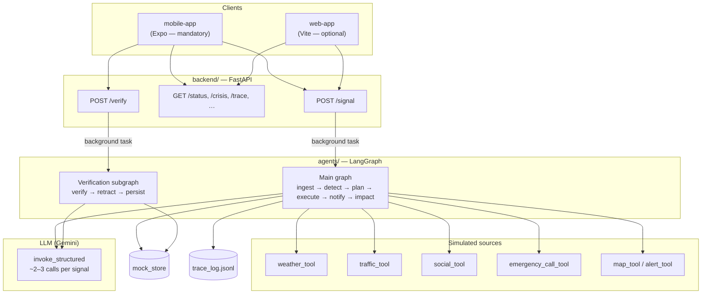

# Architecture

NigehbaanAI is a **three-tier prototype**: mobile/web clients → FastAPI backend → LangGraph agent pipeline. All crisis data and agent outputs flow through a shared in-memory store and JSONL trace log.

---

## High-level diagram



---

## Request lifecycle

### 1. Signal submission

```
Client  →  POST /api/v1/signal
       →  FastAPI creates signal_id, upserts { status: "queued" }
       →  BackgroundTasks runs agents.orchestrator.process_signal()
       →  202 Accepted (client polls for results)
```

The API returns immediately. Processing runs asynchronously so mobile clients can show a loading state and poll endpoints.

### 2. Main pipeline (LangGraph)

| Step | Node | LLM? | Output in state |
|------|------|------|-----------------|
| 1 | `ingest` | No | Raw tool payloads, degraded warnings |
| 2 | `compress` | No | Compact `signal_digest` for prompts |
| 3 | `detect` | **Yes** | Fusion, classification, severity; may set `skip_response` |
| 4 | *route* | No | Duplicate → finalize; low confidence → review; else continue |
| 5 | `plan_resources` | **Yes** | Resource plan with trade-offs |
| 6 | `execute_actions` | No | Tool results per action step |
| 7 | `notify_stakeholders` | **Small** | Messages for 6 audience types |
| 8 | `assess_impact` | No | Before/after metrics |
| 9 | `finalize_*` | No | Persist to `mock_store`, set final status |

See [agents/README.md](../agents/README.md) for file-level detail.

### 3. Verification (separate graph)

Triggered by `POST /api/v1/verify/{signal_id}` with a field report:

```
verify_node  →  LLM compares field report to original detection
retract_node →  Withdraw public alerts if false alarm
persist      →  Update incident status (confirmed | corrected | false_alarm)
```

---

## Shared state

All graph nodes read and write a single **`CrisisState`** TypedDict (`agents/graph/state.py`):

- Input: `signal_id`, `location`, `payload`
- Ingest: tool results, `warnings`, `degraded_mode`
- Detection: `detection`, `skip_response`, `is_duplicate`
- Response: `response.plan`, `response.execution`, `response.notifications`
- Outcome: `impact`, `status`, `pipeline_stats`

The orchestrator merges the final state into `incident_store[signal_id]`.

---

## Data stores

| Store | Location | Purpose | Persistence |
|-------|----------|---------|-------------|
| **Incident store** | `backend/app/database/mock_store.py` | Full incident records keyed by `signal_id` | In-memory (lost on restart) |
| **Resource ledger** | Same module | Shared ambulance/police/rescue pool for multi-crisis | In-memory |
| **Trace log** | `agents/traces/trace_log.jsonl` | Agent events (workplan, tool_call, llm_call, final_outcome) | Append-only file |

Both FastAPI and the agent pipeline import the same `mock_store` module (via `PYTHONPATH` in Docker).

---

## LLM design

The pipeline was optimized from many small agent calls to **few structured calls**:

| Call | Schema | When |
|------|--------|------|
| Merged detect | `DetectionResult` | After compress |
| Resource plan | `ResponsePlan` | After successful detect |
| Notify polish | Text (optional) | After execute |
| Verification | `VerificationOutput` | On field report |

**Modes** (`LLM_MODE` in `.env`):

| Mode | Behavior |
|------|----------|
| `mock` | Never calls Gemini; uses `agents/mock_llm_payloads.py` |
| `auto` | Default; calls Gemini, falls back to mocks on quota/key errors |
| `real` | Fail on LLM errors |

When mocks run, incidents get `simulated_llm_pipeline: true`.

---

## Robustness

Handled in `agents/robustness/degraded.py` and ingest/detect nodes:

- **API failure simulation** — `simulate_api_failure` in payload; cached fallbacks
- **Duplicate detection** — Same location within time window → `finalize_duplicate`
- **Low confidence** — Few sources or confidence &lt; 0.5 → `finalize_review` (human escalation)
- **Resource caps** — `enforce_resource_caps` against `DEFAULT_RESOURCES`

---

## Client integration pattern

Mobile and web apps follow the same pattern:

1. `POST /signal` → get `signal_id`
2. Poll every ~2s:
   - `GET /status/{id}` — full record
   - Or granular: `/crisis`, `/agents/trace`, `/actions`, `/outcome`
3. Render detection, trace log, action list, impact stats
4. Optional: `POST /verify/{id}` for false-alarm demo

`SignalContext` in the mobile app encapsulates this polling logic.

---

## Scalability

Current prototype limits and typical next steps:

| Concern | Prototype | At scale |
|---------|-----------|----------|
| Storage | In-memory dict | PostgreSQL + Redis cache |
| Queue | FastAPI BackgroundTasks | Celery / Cloud Tasks |
| Multi-instance | Single process | Shared Redis store, idempotent workers |
| LLM cost | ~2–3 calls × ~$0.003/call | Batch digest, cache tool results by location |
| Traces | Local JSONL | OpenTelemetry / LangSmith |

Estimated full pipeline: **10–30 s**, **~$0.01** per signal with Gemini Flash.

---

## Baseline comparison

| | Legacy stub | NigehbaanAI |
|---|-------------|-------------|
| Path | `scripts/legacy/orchestrator_stub.py` | `agents/orchestrator.py` |
| Detection | Keyword if/else | Multi-source fusion + LLM |
| Planning | Fixed template | Resource trade-offs, multi-crisis |
| Verification | None | Retraction + correction |
| Traces | None | JSONL audit log |

Run: `python scripts/baseline_comparison.py`

---

## Security & privacy (prototype)

- CORS is open (`*`) for hackathon demos — tighten for production.
- No authentication on API endpoints.
- All tool outputs marked `[SIMULATED]`.
- Locations are district-level only; no PII in mock data.
