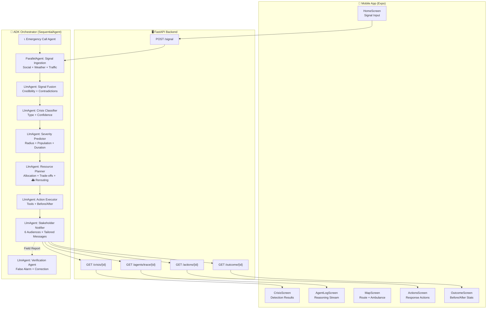

# 🚨 NigehbaanAI — Master Implementation Plan

## 2-Day Sprint | 4 People | Challenge 3: CIRO

---

## Team & Roles

| Person | Role | Day 1 Focus | Day 2 Focus |
|--------|------|-------------|-------------|
| **Danish** | Backend Lead | ADK setup, Detection agents, Executor agent | Verification agent, Ambulance rerouting, Trace polish |
| **Umer** | Backend Dev | Signal tools, Planner agent, Notification agent, APIs | Degraded mode, Emergency call, README docs |
| **Adeel** | Frontend Lead | App setup, HomeScreen, MapScreen, OutcomeScreen | API integration, Emergency Call UI, Demo video |
| **Frontend Dev** | Frontend Dev | CrisisScreen, AgentLogScreen, ActionsScreen | Multi-crisis view, False alarm UI, Device testing |

---

## Master Timeline

```
DAY 1 (Today)
├── Backend Phase 1 (5-6 hrs): ADK + Core Agents + Detection Pipeline
├── Backend Phase 2 (4-5 hrs): Planning + Execution + Multi-Crisis
├── Frontend Phase 1 (8-10 hrs): All 7 screens with mock data
│
DAY 2 (Tomorrow)
├── Backend Phase 3 (3-4 hrs): Robustness + Creative Features
├── Backend Phase 4 (4-5 hrs): Polish + Docs + Submission
├── Frontend Phase 2 (8-10 hrs): API integration + Polish + Demo Video
```

---

## Architecture Overview



---

## Creative Features (What Makes Us Stand Out)

### 🆕 Emergency Call as Signal Source
- Simulated emergency number (1122)
- Call recording → LLM transcription → location/type/urgency extraction
- Urdu + English: "Pani ghar mein aa raha hai, G-10, madad chahiye!"
- **Highest credibility source** — trumps social media posts
- Shows as 4th signal source in the ingestion pipeline

### 🚑 Ambulance Rerouting
- When roads are blocked by crisis, ambulances can't use normal routes
- Planner considers blocked roads → finds optimal ambulance route
- Map shows ambulance marker moving along alternate path
- ETA improvement: 25 min → 12 min

### 🌐 Urdu + English NLP
- Signal input accepts both languages
- LLM naturally handles code-switching
- Stakeholder messages generated in appropriate language

---

## Demo Scenarios (3 Scenarios for Video)

### Scenario 1: Happy Path — G-10 Flooding
```
Input: "Streets flooded in G-10! Water entering homes. Need help NOW!"
       + Weather: Heavy rain + Traffic: Severe congestion

→ Detection: Urban flooding, 92% confidence, HIGH severity
→ Plan: 3 rescue teams, 4 police, 2 ambulances
→ Actions: Reroute traffic, dispatch, public alert, hospital notify
→ Outcome: Congestion 87% → 23%, Response time 8 min
```

### Scenario 2: Multi-Crisis — G-10 Flood + F-8 Heatwave
```
While G-10 flood is active:
Input: "Elderly people collapsing from heat in F-8"
       + Weather: 46°C extreme heat

→ Planner shows trade-offs:
  "G-10 (HIGH) gets 3 rescue teams; F-8 (MEDIUM) gets 5 field teams"
  "10% resource reserve maintained"
→ Both crises managed simultaneously
```

### Scenario 3: False Alarm — Water Main Correction
```
After G-10 flood detection:
Field Report: "Actually a broken water main, not flooding"
Sensor Data: Water level normal

→ Verification Agent kicks in
→ Classification: flood → infrastructure_failure
→ Alert retracted + apology issued
→ Utility company notified instead
```

---

## Phase Files (Detailed Task Breakdown)

| Phase File | Team | When |
|-----------|------|------|
| [phase1_backend_agents.md](./phases/phase1_backend_agents.md) | Danish + Umer | Day 1, First Half |
| [phase2_planning_execution.md](./phases/phase2_planning_execution.md) | Danish + Umer | Day 1, Second Half |
| [phase3_robustness.md](./phases/phase3_robustness.md) | Danish + Umer | Day 2, First Half |
| [phase4_polish_docs.md](./phases/phase4_polish_docs.md) | All | Day 2, Second Half |
| [frontend_phase1.md](./phases/frontend_phase1.md) | Adeel + FE Dev | Day 1 |
| [frontend_phase2.md](./phases/frontend_phase2.md) | Adeel + FE Dev | Day 2 |

---

## Scoring Strategy

| Criteria | Weight | Our Approach |
|----------|--------|-------------|
| **Antigravity integration** | 20% | Real ADK with LlmAgent, SequentialAgent, ParallelAgent. Rich JSONL traces. |
| **Crisis detection & severity** | 25% | LLM-powered signal fusion, credibility scoring, contradiction detection. |
| **Resource optimization** | 20% | LLM trade-off reasoning for 2 simultaneous crises + ambulance rerouting. |
| **Impact simulation** | 15% | Before/after for every action. Map animations. Stakeholder-specific messages. |
| **Robustness** | 10% | False alarm flow, API fallback, conflicting signals, degraded mode. |
| **Innovation & UX** | 10% | Emergency call feature, ambulance rerouting, Urdu NLP, streaming agent logs. |

---

## Quick Start for Backend Team

```bash
# 1. Set up environment
cd /home/danish/WindowsBackup/Django/NigehbaanAI
python -m venv venv
source venv/bin/activate
pip install -r requirements.txt

# 2. Set API key
cp .env.example .env
# Edit .env → GOOGLE_API_KEY=your-actual-key

# 3. Run server
cd backend
uvicorn app.main:app --reload --port 8000

# 4. Test
curl http://localhost:8000/health
```
