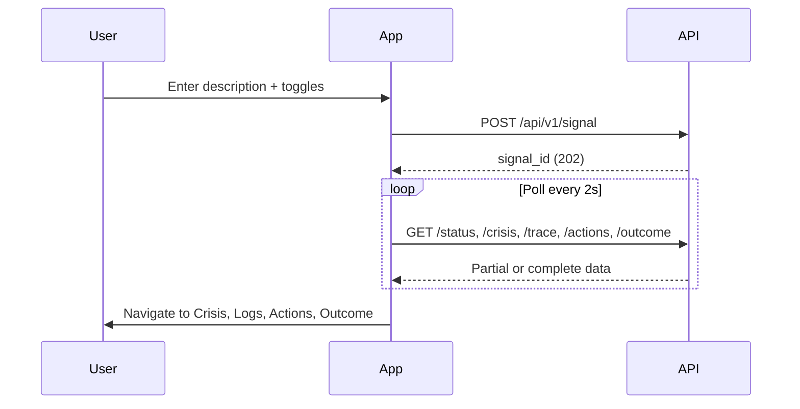

# Mobile App — Expo (React Native)

**Mandatory hackathon deliverable.** Crisis dashboard for submitting signals, viewing detection, agent traces, actions, map, and outcomes.

Runs in **Expo Go** (physical device), iOS/Android simulator, or **web preview** at http://localhost:8081 when using Docker.

---

## Stack

| Technology | Role |
|------------|------|
| Expo SDK | Build, Metro bundler, Expo Go |
| Expo Router | File-based routing (`app/`) |
| React Native Paper | UI components |
| TypeScript | Types for API responses |

---

## Project layout

```
mobile-app/
├── app/                    # Expo Router screens
│   ├── index.tsx           # Dashboard — submit signal, summary cards
│   ├── crisis.tsx          # Detection results
│   ├── logs.tsx            # Agent trace stream
│   ├── actions.tsx         # Executed actions
│   ├── outcome.tsx         # Before/after impact
│   ├── map.tsx             # Route / map (native vs web split)
│   ├── alerts.tsx          # Notifications
│   ├── settings.tsx        # API URL display, toggles
│   └── profile.tsx
├── src/
│   ├── api/
│   │   ├── client.ts       # HTTP calls to backend
│   │   ├── types.ts        # API + UI types
│   │   └── mappers.ts      # API → UI shape
│   ├── context/
│   │   └── SignalContext.tsx   # Polling, signal lifecycle
│   ├── components/
│   └── screens/
│       ├── Map.native.tsx  # react-native-maps (Expo Go)
│       ├── Map.web.tsx     # Google Maps JS (browser)
│       └── GoogleMapWeb.tsx
├── app.json                # Expo config, native Maps keys
└── package.json
```

---

## Configuration

Set in repo root `.env` (read by Docker Compose):

| Variable | Purpose |
|----------|---------|
| `EXPO_PUBLIC_API_URL` | Backend base URL (e.g. `http://192.168.x.x:8000` on phone) |
| `REACT_NATIVE_PACKAGER_HOSTNAME` | LAN IP for Expo Go QR code |
| `EXPO_PUBLIC_GOOGLE_MAPS_KEY` | Web map tab only |

**Important:** On a physical phone, never use `localhost` for the API — use your computer's LAN IP. See [Getting started](../docs/getting-started.md#4-expo-go-on-a-physical-phone).

---

## User flow



`SignalContext` (`src/context/SignalContext.tsx`) owns:

- `startAnalysis()` — submit signal
- Polling with timeout (90s default)
- Mapped UI state: `uiCrisis`, `traces`, `actions`, `outcomeStats`
- `degradedMode`, `warnings`, `simulatedLlmPipeline` banners
- `loadMultiCrisis()` — calls `POST /scenario/multi-crisis`
- `verifySignal()` — false-alarm demo

---

## Screens

| Route | Screen | Data source |
|-------|--------|-------------|
| `/` | Dashboard | Submit + summary; links to detail screens |
| `/crisis` | Crisis | `GET /crisis/{id}` |
| `/logs` | Agent logs | `GET /agents/trace/{id}` |
| `/actions` | Actions | `GET /actions/{id}` |
| `/outcome` | Outcome | `GET /outcome/{id}` |
| `/map` | Map | Plan/execution geo hints |
| `/alerts` | Alerts | Notifications from outcome/status |
| `/settings` | Settings | Env / feature toggles |

---

## Running

**With Docker (from repo root):**

```bash
./scripts/dev.sh
# Open http://localhost:8081 or scan QR in Expo Go
```

**Without Docker:**

```bash
cd mobile-app
npm install
EXPO_PUBLIC_API_URL=http://localhost:8000 npx expo start
```

Press `w` for web, `a` for Android emulator, scan QR for Expo Go.

---

## Web vs native maps

`react-native-maps` does not work on web. Metro resolves:

- `Map.native.tsx` — full maps on device/simulator
- `Map.web.tsx` — Google Maps JavaScript API in browser

Restrict your Maps API key by HTTP referrer in Google Cloud Console.

---

## API client

[`src/api/client.ts`](src/api/client.ts) wraps `fetch` against `EXPO_PUBLIC_API_URL`:

- `submitSignal`, `fetchPipelineSnapshot`, `verifySignal`, `runMultiCrisisScenario`

Mappers in [`mappers.ts`](src/api/mappers.ts) normalize backend shapes for UI components.

---

## Docs

- [API reference](../docs/api-reference.md)
- [Getting started](../docs/getting-started.md)
- [Architecture](../docs/architecture.md)
